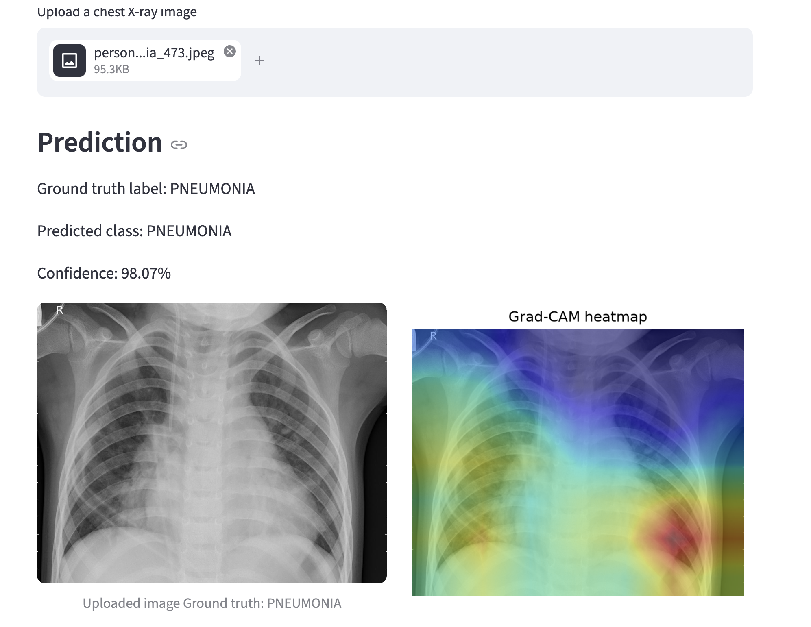

# Transfer Learning for Chest X-ray Classification

This project is designed as a teaching lab for a 4th-year Computer Vision module.

The goal is to show how a pre-trained ResNet18 model can be adapted to chest X-ray classification using transfer learning and fine-tuning. The app also displays a Grad-CAM heatmap so students can see which regions of the image influenced the model's decision.

## Project overview



## Dataset source

This project uses the Chest X-Ray Pneumonia dataset from Paul Mooney on Kaggle:
https://www.kaggle.com/paultimothymooney/chest-xray-pneumonia

The raw dataset is not included in this repository. It should be downloaded separately and placed in the local `data/` folder before training.

## Project structure

- `data/` contains the chest X-ray dataset
- `models/` stores trained model weights
- `Illustrations/` contains project screenshots and UI mockups
- `model.py` creates the ResNet18 transfer-learning model
- `data_utils.py` loads the dataset and prepares DataLoaders
- `training_utils.py` trains and evaluates the model
- `gradcam.py` creates Grad-CAM explanations
- `train.py` runs the training workflow
- `app.py` launches the Streamlit web app

## Why ResNet18?

ResNet18 is a good teaching choice because it is widely used, relatively small, fast to train, and easy to understand. It is available directly in `torchvision.models` and comes with ImageNet pre-trained weights.

## How the project is taught

The code is intentionally simple and heavily commented so students can see:

- how transfer learning reuses ImageNet features
- how the new classifier replaces the original output layer
- how layers are frozen and unfrozen
- how PyTorch trains the model
- how Grad-CAM highlights important regions

## Quick start

1. Create the virtual environment:

   ```bash
   python3 -m venv .venv
   source .venv/bin/activate
   ```

2. Install requirements:

   ```bash
   pip install -r requirements.txt
   ```

3. Download the Chest X-ray Pneumonia dataset and place it under `data/` using one of the supported folder structures.

4. Train the model:

   ```bash
   python train.py
   ```

5. Launch the Streamlit app:

   ```bash
   streamlit run app.py
   ```

## Supported dataset layouts

The loader supports:

- `data/train/NORMAL`, `data/train/PNEUMONIA`, etc.
- `data/NORMAL`, `data/PNEUMONIA` with automatic train/val/test splitting

The class names are detected automatically from the folders instead of being hard-coded.
